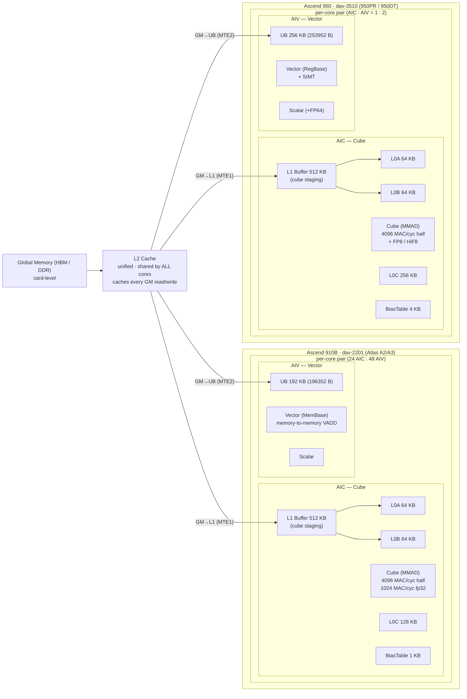
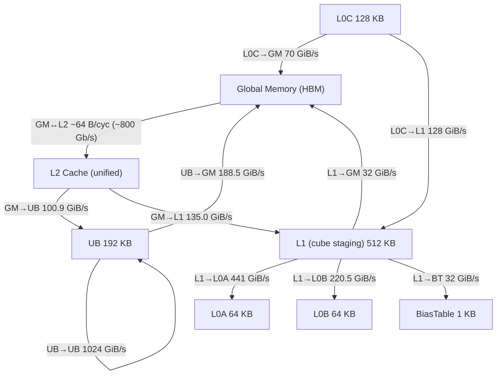
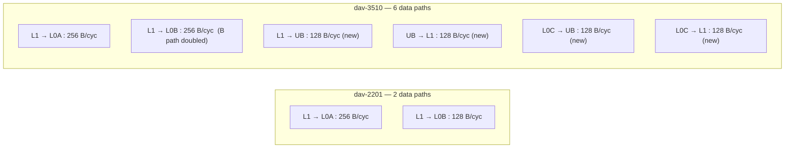
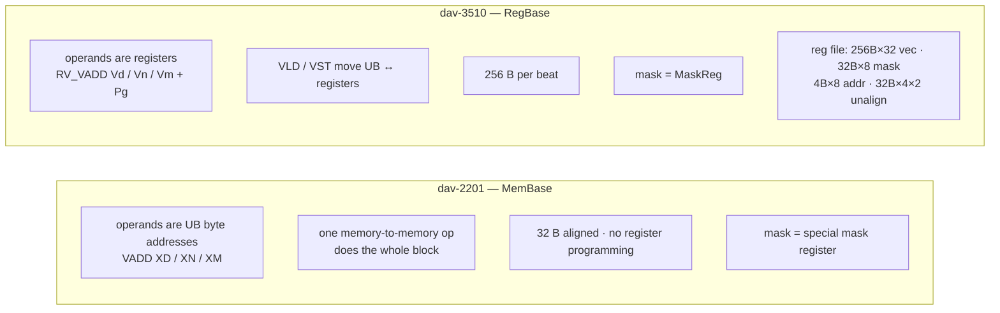
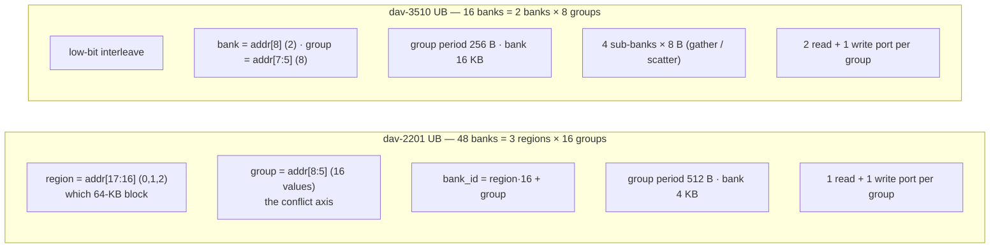
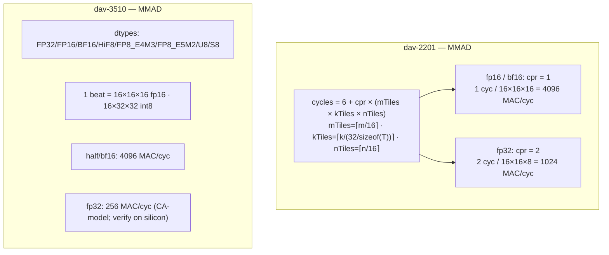
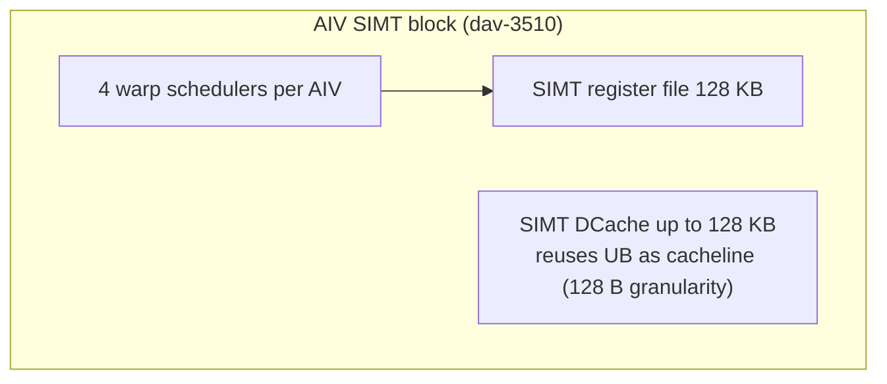

# 11 — Ascend 950 (dav-3510) vs 910B (dav-2201) hardware characteristics

## What we did

Consolidated everything we know about the two chips into one place: the vendor
architecture-spec docs (`npu_arch_2201.md` / `npu_arch_3510.md`), the PTO cost
model we extracted (`vendor-src/pto/`), our own simulator measurements, and the
UB bank structure from report 09. Then drew it up as a set of diagrams — one big
overview plus focused views per hardware component.

## Why we did it

The deferred task "950 vs 910 characteristics" had been sitting in `docs/TODO.md`
since the early sessions. Every experiment so far (banks, cube peak, SIMT, PTO)
has produced a fragment of this picture, but nothing assembled the fragments
side by side. A set of diagrams makes the *differences* between the two
generations immediately visible.

## What we wanted to check

For each generation: memory hierarchy sizes + bandwidth, the compute units
(cube / vector / scalar), the data paths between buffers, the UB bank structure,
and the SIMT block (950 only) — all with the actual numbers, so a reader can
compare 910B and 950 without re-reading five reports.

## The big picture



The **L2 Cache is the unified, shared** layer (off-core, between GM and every
core); **L1 is not unified** — it is a per-AIC buffer inside the cube that
stages A/B matrix tiles (`L1→L0A/L0B`). The vector unit reads GM straight into
UB (through L2, not through L1).

## Buffers, side by side

| buffer | dav-2201 (910B) | dav-3510 (950) | change |
|---|---|---|---|
| UB | 192 KB (196352 B) | 256 KB (253952 B) | +33 % |
| L1 | 512 KB (523776 B) | 512 KB (524288 B) | — |
| L0A | 64 KB | 64 KB | — |
| L0B | 64 KB | 64 KB | — |
| L0C | 128 KB | 256 KB | **×2** |
| BiasTable | 1 KB | 4 KB | ×4 |
| Fixpipe | 2 KB | 4 KB | ×2 |

Notes: 2201 reserves 256 B in both UB and L1; 3510 UB = 248 KB + VF stack
(~6 KB) + reserve (~2 KB), and shrinks by 32–128 KB when SIMD+SIMT DCache share
UB (down to ~224 KB usable).

## Memory bandwidth

Two distinct bandwidth models exist in the PTO cost model, and neither is a set
of physical point-to-point links — every GM access goes through the off-core
**L2 Cache** first (`basic_architecture.md:206`: all MTE GM traffic is cached in
L2 by default).

**Model 1 — the `perf_sim` cache model** (`pto/costmodel/perf_sim/config.hpp`),
which *does* model L2 explicitly (bytes/cycle, × 1.85 GHz):

| hop | bandwidth |
|---|---|
| GM → L2 (`gm_read_bw`) | 64 B/cyc ≈ 118 GB/s ≈ 950 Gb/s |
| L2 → core (`l2_read_bw`) | 256 B/cyc ≈ 474 GB/s |
| L2 cache line / hit / miss-extra | 512 B / 50 cyc / 150 cyc |

So the physical GM↔L2 bottleneck is ~64 B/cyc (~800–950 Gb/s). Any GM→UB or
GM→L1 traffic is bounded by this shared hop, **not** by a dedicated per-buffer
pipe.

**Model 2 — the 2201 `formula` cost model** (`arch_config.hpp`,
`kA2A3ArchConfig`), a flat per-pipe GiB/s table used by
`EstimateBandwidthCycles`. These are *effective* per-pipe numbers (already
inclusive of the L2 path), not independent physical links:



The `L1→L0A : L1→L0B` ratio is exactly **2 : 1** (441 : 220.5), matching the
arch-spec 256 : 128 B/cycle. The two generations' *on-core data paths* (per
the arch spec, B/cycle):



950 keeps the cube feed paths, adds `UB↔L1` and `L0C→UB`, and drops the old
`GM→L0A/B` direct feeds. The vector's GM path (GM→UB via L2) is unchanged — UB
is fed from GM/L2 directly, **not** through L1.

## Vector unit: MemBase → RegBase



The architectural register file is 32 × 256 B vector registers (the PTO
`uarch.csv` says `vreg_num=68`, i.e. 68 *physical* registers with renaming).

## UB bank structure (from report 09)



Both generations read **16 rows = 512 B per beat** across their bank groups;
950 gets there with 8 groups × 2 banks, 910B with 16 groups × 1 bank.

## Cube unit



Measured cube peak (CA-model sim, ~1.8 GHz):

| dtype | 910B | 950 | ideal ratio |
|---|---|---|---|
| half / bf16 | 4096 MAC/cyc (14.7 TFLOPS) | 4096 MAC/cyc (14.7 TFLOPS) | 1.00 |
| int8 | 8192 (29.5 TOPS) | 8192 (29.5 TOPS) | 1.00 |
| float | 1024 MAC/cyc (3.68 TFLOPS) | 256 MAC/cyc (0.92 TFLOPS) | 2.0 / 8.0 |

## SIMT (950 only)



Thread → register mapping (SIMT register file is 128 KB total):

| threads per block | registers per thread |
|---|---|
| 1 – 256 | 127 |
| 257 – 512 | 64 |
| 513 – 1024 | 32 |
| 1025 – 2048 | 16 |

## Vector-instruction timing (950, from `isa.csv`)

| op | latency | throughput |
|---|---|---|
| VADD / VSUB (fp32) | 7 | 2 |
| VMUL (fp32) | 8 | 2 |
| VMAX / VMIN (fp32) | 6 | 2 |
| VADDS (scalar) | 7 | 1 |
| VMULS (scalar) | 8 | 1 |
| VLDS (load) / VSTS (store) | 9 | 1 |
| VEXP (fp32) | 16 | 4 |
| VDIV (fp32) | 17 | 4 |
| VCADD (fp32) | 22 | 1 |

`uarch.csv` (950): issue ports 2, load ports 2, store ports 1, IDU issue width
5, IDU window 6, SHQ depth 58, EXQ depth 26. Vector-instruction queue depth
(AIC/AIV) is 0/64 on 910B vs 0/32 on 950.

## Inter-core communication & sync

- 910B: inter-core data goes through **Global Memory**.
- 950: inter-core data via **SSBuffer**; adds a 1:1 AIC:AIV sync mode (mode 4).

## Source map

Every number above traces to a file:line. Paths are under `vendor-src/` (gitignored;
re-copy per report 10). Abbreviations used below:

- `AS2201` = `asc-devkit/docs/zh/guide/programming_guide/advanced_programming/hardware_implementation/architecture_spec/npu_arch_2201.md`
- `AS3510` = same dir, `npu_arch_3510.md`
- `BANK2201` / `BANK3510` = `asc-devkit/docs/zh/guide/operator_practice/simd_operator_optimization/memory_access/avoid_ub_bank_conflict/avoid_bank_conflict_npu_arch_{2201,3510}.md`
- `ARCH` = `pto/costmodel/arch_config.hpp`
- `MAD` = `pto/costmodel/a2a3/formula_costmodel/formula_backend_compute.hpp`
- `FORMULA` = `pto/costmodel/a2a3/formula_costmodel/formula_params.csv`
- `ISA` = `pto/costmodel/a5/VfSim/params/isa.csv`
- `UARCH` = `pto/costmodel/a5/VfSim/params/uarch.csv`
- `BASIC` = `asc-devkit/docs/zh/guide/programming_guide/advanced_programming/hardware_implementation/basic_architecture.md`
- `PSIM` = `pto/costmodel/perf_sim/config.hpp`

### Buffers

| value | source |
|---|---|
| UB 192 KB (`192*1024-256`) | `AS2201:45` |
| L1 512 KB / L0A 64 / L0B 64 / L0C 128 / BT 1 / Fixpipe 2 | `AS2201:46-51` |
| UB 256 KB (`248*1024 + VF_STACK + RESERVE`) | `AS3510:89` |
| L1 512 / L0A 64 / L0B 64 / L0C 256 / BT 4 / Fixpipe 4 | `AS3510:90-95` |
| 3510 usable 224 KB (SIMD+SIMT DCache share) | `AS3510:121` |

### Data paths (B/cycle)

| value | source |
|---|---|
| 2201: L1→L0A 256, L1→L0B 128 | `AS2201:67-68` |
| 3510: L1→L0A 256, L1→L0B 256, L1→UB 128, UB→L1 128, L0C→UB 128, L0C→L1 128 | `AS3510:131-136` |
| 3510 "adds L0C→UB / UB↔L1, drops GM→L0A/B" | `AS3510:13-14` |

### Memory bandwidth (GiB/s, 2201 only — PTO has no a5 table)

| value | source |
|---|---|
| GM→UB 100.9, GM→L1 135.0, UB→GM 188.46, L1→GM 32, UB→UB 1024, L0C→GM 70, L0C→L1 128, L1→L0A 441, L1→L0B 220.5, L1→BT/FB/FILL 32 | `ARCH:105-116` (fields listed in `ARCH:101` `kA2A3ArchConfig`) |
| frequency 1.85 GHz | `ARCH:24` |
| `kBytesPerGb` (units are GiB/s) | `ARCH:23` |

### Memory hierarchy & L2 (the shared cache)

| value | source |
|---|---|
| L2 Cache is off-core, shared by all Vector Cores, sits between GM and each core's Data Cache | `abstract_hardware_architecture.md:16` (SIMT doc) |
| L2 Cache = off-core shared cache for GM data (all MTE GM reads/writes cached by default) | `BASIC:113`, `BASIC:206` |
| L1 Buffer = inside AI Core, a staging area for Cube data (not unified/shared) | `BASIC:137` |
| `gm_read_bw=64 B/cyc`, `l2_read_bw=256 B/cyc`, `l2_cache_line=512`, `l2_hit_latency=50`, `l2_miss_extra_latency=150` | `PSIM:49-50,53-54` (perf_sim cache model, pypto defaults) |

### Vector unit (MemBase → RegBase)

| value | source |
|---|---|
| 3510 mask = MaskReg (2201 reads special mask register) | `AS3510:58` |
| register spec: vec 256B×32, mask 32B×8, addr 4B×8, unalign 32B×4 ×2 | `AS3510:99-105` |
| vector dtypes (3510) | `AS3510:55` |
| 32 vector registers (arch) vs 68 physical (PTO) | `AS3510:101` + `UARCH:8` |

### UB bank structure

| value | source |
|---|---|
| 2201: 192 KB = 48 banks / 16 groups / 3 per group (bank15,31,47 = one group), bank = 128 rows × 32 B | `BANK2201:14` |
| 2201: vector unit reads/writes 1 row per bank group per beat | `BANK2201:21` |
| 2201 conflicts: read/write same bank; write/write same group; read/read same group | `BANK2201:27-29` |
| 2201: 8 DataBlocks in one group → 8 beats (stride-16 write example) | `BANK2201:125` |
| 3510: 256 KB = 8 groups × 2 banks, bank 16 KB = 512 rows × 32 B, low-bit interleave | `BANK3510:11` |
| 3510: 4 sub-banks × 8 B (gather/scatter only) | `BANK3510:28` |
| 3510: same group = 2 reads OR 1 read + 1 write | `BANK3510:36` |
| 3510 conflicts: read/write same bank (or 2R+1W same group); write/write same group; read/read 2 reads same bank or ≥3 same group | `BANK3510:38-40` |
| 3510 sub-bank conflict rules (gather/scatter) | `BANK3510:244-246` |
| bank_id = region·16 + group (2201), region=addr[17:16], group=addr[8:5] | derived in report 09 (empirical + doc examples) |

### Cube unit

| value | source |
|---|---|
| 3510 cube dtypes: FP32/FP16/BF16/HiF8/FP8_E4M3/FP8_E5M2/U8/S8 | `AS3510:68` |
| 3510 1 beat = 16×16×16 fp16 / 16×32×32 int8 | `AS3510:68` |
| 2201 cycles = 6 + cpr·(mTiles·kTiles·nTiles), kHeadCycles=6, kMTile=kNTile=16, kCyclePerRepeat = 2 (float) / 1 (else) | `MAD:73-88` |

### SIMT (3510 only)

| value | source |
|---|---|
| 4 warp schedulers per AIV | `AS3510:35` |
| SIMT register file 128 KB + thread→reg mapping | `AS3510:40` |
| SIMT DCache up to 128 KB, reuses UB, 128-B granularity | `AS3510:29` |

### Vector-instruction timing (isa.csv, 3510)

| value | source |
|---|---|
| VADD fp32 6,7,2,5 (startup,latency,throughput,drain) | `ISA:6` |
| VSUB 7/2, VMUL 8/2, VMAX/VMIN 6/2 | `ISA:14,16,22,24` |
| VADDS 7/1, VMULS 8/1 | `ISA:2,8` |
| VLDS 9/1, VSTS 9/1 | `ISA:32,34` |
| VEXP 16/4, VDIV 17/4, VCADD 22/1 | `ISA:4,10,30` |
| uarch: issue_ports 2, load_ports 2, store_ports 1, IDU width 6/issue 5, vreg_num 68, shq 58, exq 26, load_done_latency 9 | `UARCH:2-6,8,10-11,28` |

### 2201 elementwise linear model (formula_params.csv)

| value | source |
|---|---|
| TADDS fp32 cols=32 slope 0.0156 bias 25 | `FORMULA:2` |
| TADDS fp16 slope 0.0078 (half) | `FORMULA:11` |

### Instruction queue depth (AIC / AIV)

| value | source |
|---|---|
| 2201: Vector 0/64, Cube 16/0, MTE1 32/0, MTE2 32/16, MTE3 32/16, FixPipe 32/0 | `AS2201:143-148` |
| 3510: Vector 0/32, Cube 16/0, MTE1 32/0, MTE2 16/16, MTE3 0/16, FixPipe 32/0 | `AS3510:254-259` |

### Inter-core comm & sync

| value | source |
|---|---|
| 2201 inter-core data via Global Memory | `AS2201:14` |
| 3510 inter-core via SSBuffer (vs GM on NPU220) | `AS3510:263` |
| 3510 sync mode 4 (1:1 AIC:AIV) | `AS3510:309` |

## Reproduce

```bash
# The arch-spec docs and the PTO cost model are the sources (vendor-src/ is
# gitignored; re-copy PTO with the docker-run one-liner from report 10).
# Arch specs:
#   vendor-src/asc-devkit/docs/zh/guide/programming_guide/advanced_programming/
#     hardware_implementation/architecture_spec/npu_arch_{2201,3510}.md
# 2201 bandwidth table (GiB/s, kA2A3ArchConfig):
#   vendor-src/pto/costmodel/arch_config.hpp
# 950 vector timing:
#   vendor-src/pto/costmodel/a5/VfSim/params/isa.csv      # VADD,f32,6,7,2,5,...
#   vendor-src/pto/costmodel/a5/VfSim/params/uarch.csv    # issue_ports=2,...
# 2201 cube formula (fp16=1 cyc/repeat, fp32=2 cyc):
#   vendor-src/pto/costmodel/a2a3/formula_costmodel/formula_backend_compute.hpp

# Measured cube peak (reproduces the "measured" table):
./scripts/docker-run.sh ./scripts/build.sh sim dav-2201
./scripts/docker-run.sh ./scripts/build.sh sim dav-3510
./scripts/docker-run.sh python3 scripts/cube_sweep.py --arch 2201
#   half 4096 MAC/cyc, float 1024 MAC/cyc ...
```

Mermaid renders these diagrams in any GitHub/VS Code markdown preview.
