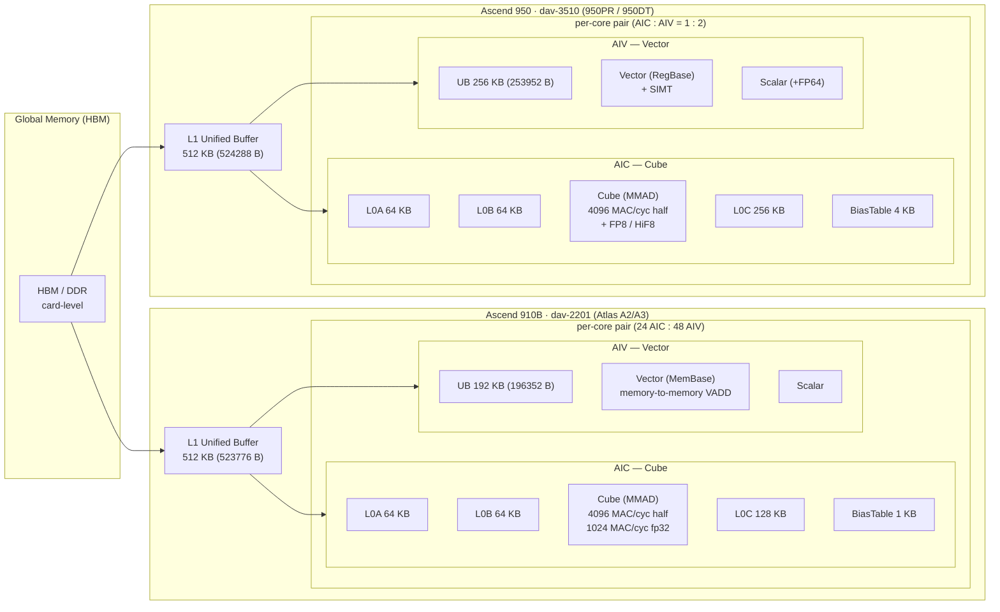
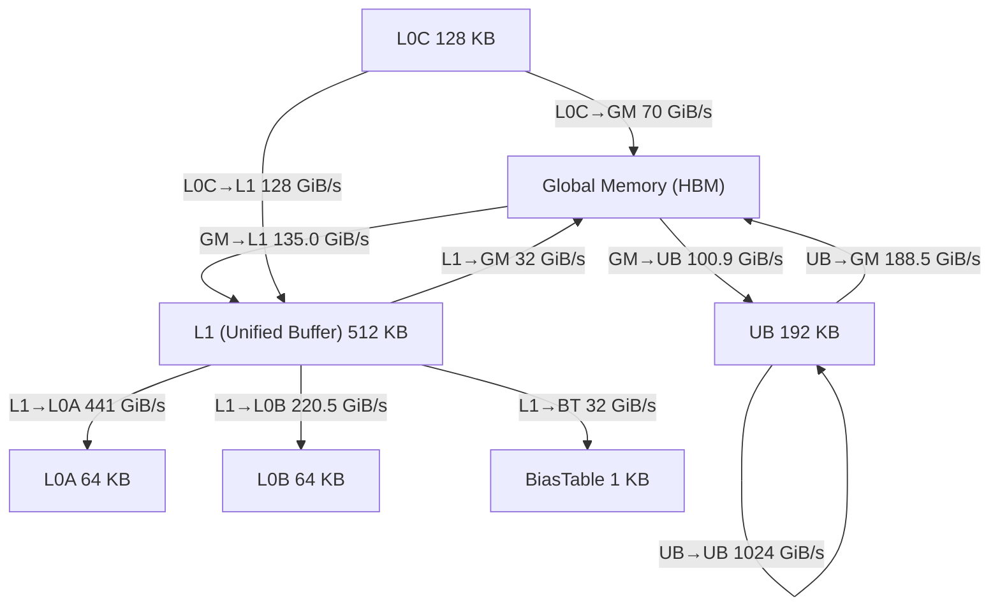
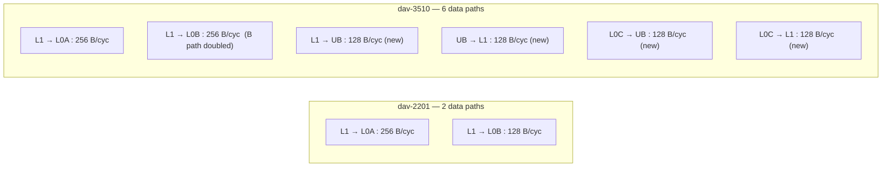
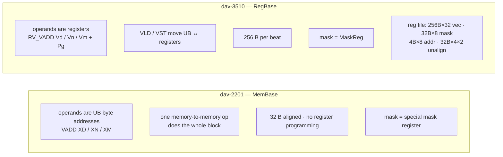
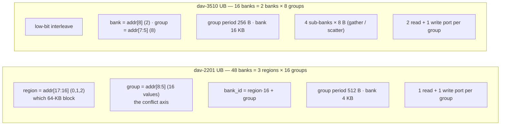
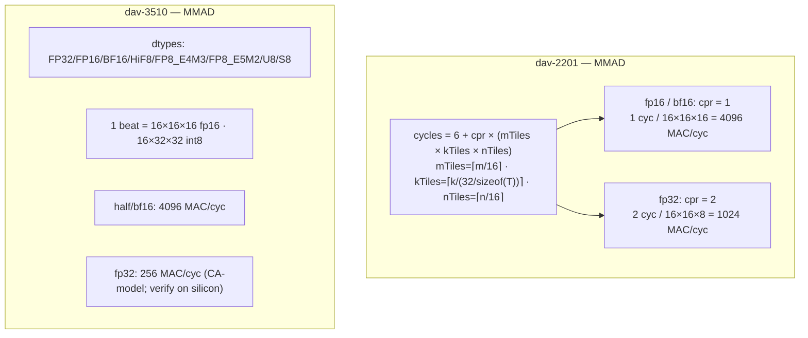
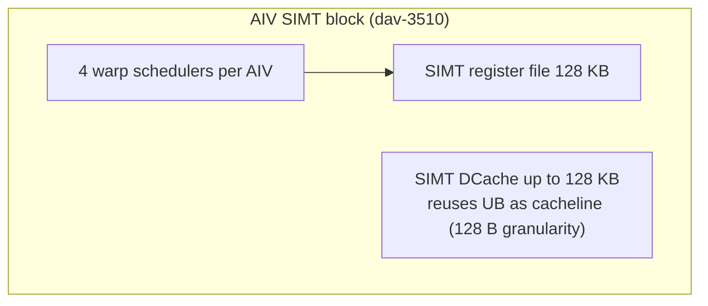

# 11 — Ascend 950 (dav-3510) vs 910B (dav-2201) hardware characteristics

## What we did

Consolidated everything we know about the two chips into one place: the vendor
architecture-spec docs (`npu_arch_2201.md` / `npu_arch_3510.md`), the PTO cost
model we extracted (`vendor-src/pto/`), our own simulator measurements, and the
UB bank structure from report 09. Then drew it up as a set of diagrams — one big
overview plus focused views per hardware component.

## Why we did it

The deferred task "950 vs 910 characteristics" had been sitting in `docs/TODO.md`
since the early sessions. Every experiment so far (banks, cube peak, SIMT, PTO)
has produced a fragment of this picture, but nothing assembled the fragments
side by side. A set of diagrams makes the *differences* between the two
generations immediately visible.

## What we wanted to check

For each generation: memory hierarchy sizes + bandwidth, the compute units
(cube / vector / scalar), the data paths between buffers, the UB bank structure,
and the SIMT block (950 only) — all with the actual numbers, so a reader can
compare 910B and 950 without re-reading five reports.

## The big picture



## Buffers, side by side

| buffer | dav-2201 (910B) | dav-3510 (950) | change |
|---|---|---|---|
| UB | 192 KB (196352 B) | 256 KB (253952 B) | +33 % |
| L1 | 512 KB (523776 B) | 512 KB (524288 B) | — |
| L0A | 64 KB | 64 KB | — |
| L0B | 64 KB | 64 KB | — |
| L0C | 128 KB | 256 KB | **×2** |
| BiasTable | 1 KB | 4 KB | ×4 |
| Fixpipe | 2 KB | 4 KB | ×2 |

Notes: 2201 reserves 256 B in both UB and L1; 3510 UB = 248 KB + VF stack
(~6 KB) + reserve (~2 KB), and shrinks by 32–128 KB when SIMD+SIMT DCache share
UB (down to ~224 KB usable).

## Memory bandwidth

2201 per-pipe bandwidth from the PTO cost model (`arch_config.hpp`,
`kA2A3ArchConfig`, frequency 1.85 GHz — the values are the model's GiB/s):



The `L1→L0A : L1→L0B` ratio is exactly **2 : 1** (441 : 220.5), matching the
arch-spec 256 : 128 B/cycle. The two generations' *data paths* (per the arch
spec, B/cycle):



950 keeps the cube feed paths and adds four new ones: `UB↔L1` and `L0C→UB`,
and drops the old `GM→L0A/B` direct feeds — everything flows through L1.

## Vector unit: MemBase → RegBase



The architectural register file is 32 × 256 B vector registers (the PTO
`uarch.csv` says `vreg_num=68`, i.e. 68 *physical* registers with renaming).

## UB bank structure (from report 09)



Both generations read **16 rows = 512 B per beat** across their bank groups;
950 gets there with 8 groups × 2 banks, 910B with 16 groups × 1 bank.

## Cube unit



Measured cube peak (CA-model sim, ~1.8 GHz):

| dtype | 910B | 950 | ideal ratio |
|---|---|---|---|
| half / bf16 | 4096 MAC/cyc (14.7 TFLOPS) | 4096 MAC/cyc (14.7 TFLOPS) | 1.00 |
| int8 | 8192 (29.5 TOPS) | 8192 (29.5 TOPS) | 1.00 |
| float | 1024 MAC/cyc (3.68 TFLOPS) | 256 MAC/cyc (0.92 TFLOPS) | 2.0 / 8.0 |

## SIMT (950 only)



Thread → register mapping (SIMT register file is 128 KB total):

| threads per block | registers per thread |
|---|---|
| 1 – 256 | 127 |
| 257 – 512 | 64 |
| 513 – 1024 | 32 |
| 1025 – 2048 | 16 |

## Vector-instruction timing (950, from `isa.csv`)

| op | latency | throughput |
|---|---|---|
| VADD / VSUB / VMUL (fp32) | 7 | 2 |
| VMAX / VMIN (fp32) | 6 | 2 |
| VADDS / VMULS (scalar) | 7 | 1 |
| VLDS (load) / VSTS (store) | 9 | 1 |
| VEXP (fp32) | 16 | 4 |
| VDIV (fp32) | 17 | 4 |
| VCADD (fp32) | 22 | 1 |

`uarch.csv` (950): issue ports 2, load ports 2, store ports 1, IDU issue width
5, IDU window 6, SHQ depth 58, EXQ depth 26. Vector-instruction queue depth
(AIC/AIV) is 0/64 on 910B vs 0/32 on 950.

## Inter-core communication & sync

- 910B: inter-core data goes through **Global Memory**.
- 950: inter-core data via **SSBuffer**; adds a 1:1 AIC:AIV sync mode (mode 4).

## Reproduce

```bash
# The arch-spec docs and the PTO cost model are the sources (vendor-src/ is
# gitignored; re-copy PTO with the docker-run one-liner from report 10).
# Arch specs:
#   vendor-src/asc-devkit/docs/zh/guide/programming_guide/advanced_programming/
#     hardware_implementation/architecture_spec/npu_arch_{2201,3510}.md
# 2201 bandwidth table (GiB/s, kA2A3ArchConfig):
#   vendor-src/pto/costmodel/arch_config.hpp
# 950 vector timing:
#   vendor-src/pto/costmodel/a5/VfSim/params/isa.csv      # VADD,f32,6,7,2,5,...
#   vendor-src/pto/costmodel/a5/VfSim/params/uarch.csv    # issue_ports=2,...
# 2201 cube formula (fp16=1 cyc/repeat, fp32=2 cyc):
#   vendor-src/pto/costmodel/a2a3/formula_costmodel/formula_backend_compute.hpp

# Measured cube peak (reproduces the "measured" table):
./scripts/docker-run.sh ./scripts/build.sh sim dav-2201
./scripts/docker-run.sh ./scripts/build.sh sim dav-3510
./scripts/docker-run.sh python3 scripts/cube_sweep.py --arch 2201
#   half 4096 MAC/cyc, float 1024 MAC/cyc ...
```

Mermaid renders these diagrams in any GitHub/VS Code markdown preview.
